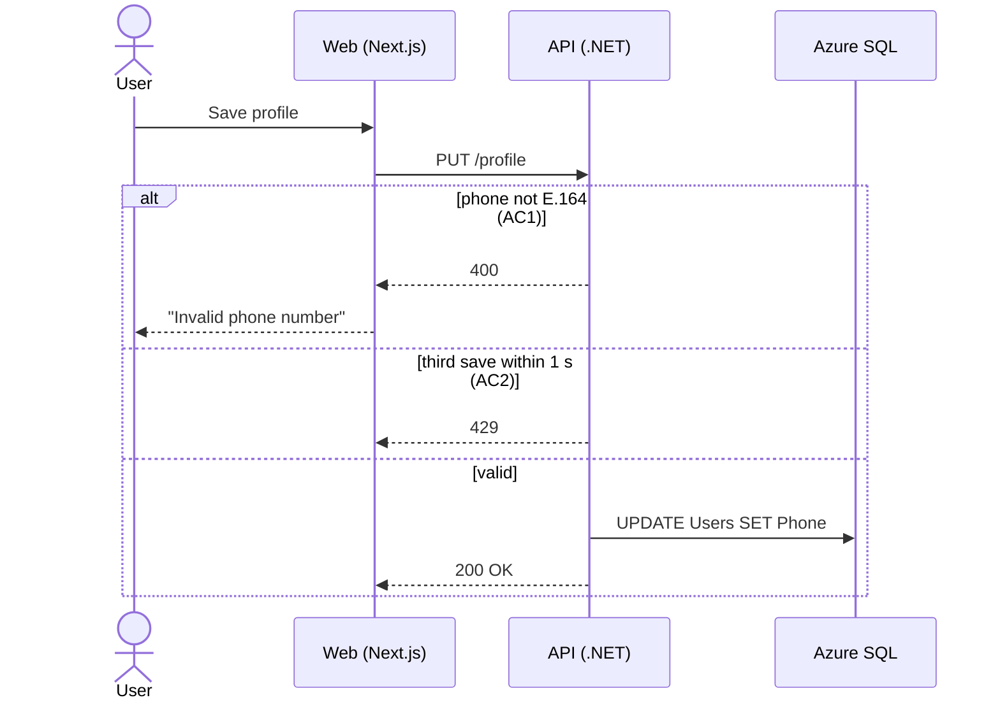

# Acceptance criteria format

This is the format from the Part 4 talk. Use it as the reference when you build the discovery skill with the participant. Rewrite the examples with the participant's own ticket; don't copy the phone example into their skill.

## What makes an AC precise

1. One behavior per AC.
2. Concrete values, not adjectives ("2 saves per second", not "fast").
3. Error cases and permissions included.
4. Out of scope written down.
5. Two people would agree on pass or fail.

If you can't write the test, the AC isn't done.

## Vague vs precise

Vague: "User can update their profile."

Precise:

- **AC1** Given a logged-in user, when they save a phone number that isn't in E.164 format, then the save is blocked and the field shows "Invalid phone number".
- **AC2** Given a logged-in user, when they save their profile more than 2 times within 1 second, then the third save is rejected with HTTP 429.

## "Must never" rules

Examples say what should happen. Rules say what must never happen. Each one becomes a property test (a test that makes up thousands of inputs and tries to break the rule).

- Always equal: cart total = sum of its lines.
- Never below: a balance never goes negative.
- Twice = once: saving twice gives the same result as saving once.

## The ACs file

`plans/<TICKET>/acs.md`:

```markdown
# <TICKET>: <title>

## AC1 Phone must be E.164
Given a logged-in user, when they save a phone number that isn't E.164,
then the save is blocked and the field shows "Invalid phone number".
Evidence: ADR-012 · Decision: any E.164 (Product Owner)

## AC2 Save rate limit
Given a logged-in user, when they save their profile more than 2 times within 1 second,
then the third save gets HTTP 429.
Evidence: PR #482 · Decision: 2 per second (Product Owner)

## Must never
- A saved phone is never stored in another format.

## Out of scope
- SMS verification.

## Open questions
- (none)
```

Every AC has `Evidence:` (where it comes from) and, if a person decided it, `Decision:` (what and who).

## Questions

Ask one question at a time. Each question:

- quotes the evidence that made it a question ("The ticket says 'phone number'. ADR-012 says we store contact data in E.164.");
- gives 2–4 concrete options;
- is saved as a decision in the AC it changes.

Example:

> The ticket says "phone number". ADR-012 says we store all contact data in E.164. Which numbers must be accepted?
> a) Finnish only  b) Any E.164  c) Anything with digits

## Sequence diagram

`plans/<TICKET>/sequence.md`, in Mermaid. As detailed as possible: every actor, call, write and error path. Each arrow that serves an AC is labelled with it. A missing arrow is a gap, and a gap is a question.


