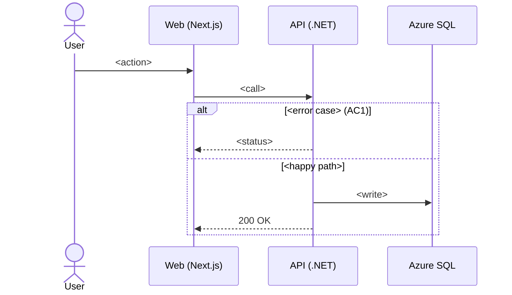

# Acceptance criteria

## The five rules

1. **One behavior per AC.** "And" between two results means two ACs.
2. **Concrete values, not adjectives.** "2 saves within 1 second", not "fast". "Max 20 characters", not "short".
3. **Error cases and permissions included.** What happens when it fails, and who may do it.
4. **Out of scope written down.** What the ticket does not cover.
5. **Two people would agree on pass or fail.** If you can't write the test, the AC isn't done.

## Format

Given / when / then, with exact values and exact texts:

> Given a logged-in user, when they save a phone number that isn't in E.164 format, then the save is blocked and the field shows "Invalid phone number".

## "Must never" rules

Examples say what should happen. Rules say what must never happen. Each rule becomes a property test: a test that makes up thousands of inputs and tries to break the rule.

| Kind | Example |
|---|---|
| Always equal | The cart total always equals the sum of its lines. |
| Never below | A balance never goes negative. |
| Twice = once | Saving twice gives the same result as saving once. |

Look for one in every ticket that saves, counts or converts something.

## acs.md template

```markdown
# <TICKET>: <title>

## AC1 <short name>
Given …, when …, then ….
Evidence: <reference> · Decision: <answer> (<name>)

## Must never
- <rule>

## Out of scope
- <item>

## Open questions
- (none)

## Not checked
- <source and why>
```

## sequence.md template

````markdown
# <TICKET>: sequence


````
