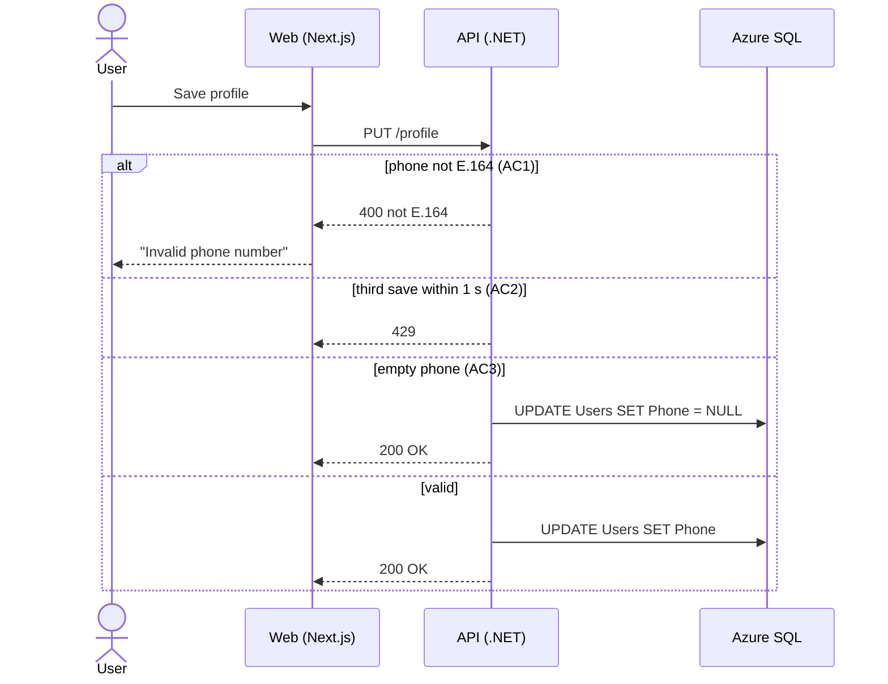

# Worked example: JIRA-1234

## The ticket

> **JIRA-1234 Phone number on profile**
> Users should be able to add their phone number to their profile.

## Evidence found

- `src/Api/Profile/ProfileController.cs:31` — `PUT /profile` saves the whole profile.
- `src/Api/Profile/ProfileRequestValidator.cs` — FluentValidation, no phone rule.
- `web/app/profile/ProfileForm.tsx` — the form, no phone field.
- `PR #482` (Azure DevOps MCP) — fixed duplicate writes on a fast double-click on Save in the address form. A review thread says: "we should rate-limit all profile saves".
- `ADR-012` (Confluence, Atlassian MCP) — "All contact data is stored in E.164."
- Logs (Azure MCP, last 14 days) — 37 `DbUpdateException` on `PUT /profile`, all within 1 second of another save by the same user.
- Figma frame "Profile / Edit" (Figma MCP) — error text under the field: "Invalid phone number".

## Gaps and conflicts shown to the user

```
Gaps:
- G1 Which phone numbers must be accepted?
- G2 What happens on a fast double-click on Save?
- G3 Can a user remove their phone number?

Conflicts:
- C1 The ticket says "phone number". ADR-012 says contact data is E.164.

Not checked:
- (none)
```

## Questions and answers

> The ticket says "phone number". ADR-012 says we store all contact data in E.164. Which numbers must be accepted?
> a) Finnish only  b) Any E.164 (recommended: matches ADR-012)  c) Anything with digits

Answer: b. → `Decision: any E.164 (Product Owner)`

> PR #482 fixed duplicate writes on a fast double-click in the address form, and the logs show 37 errors from saves less than 1 second apart. What should happen here?
> a) Ignore it  b) Limit to 2 saves per second, the third gets 429  c) Disable the button while saving

Answer: b. → `Decision: 2 per second (Product Owner)`

> Can a user remove their phone number after saving it?
> a) Yes, an empty field removes it  b) No

Answer: a. → `Decision: empty removes it (Product Owner)`

## Bad → good

| Bad | Why it fails | Good |
|---|---|---|
| "Phone number is validated." | No value, no result. | "…when they save a phone number that isn't E.164, then the save is blocked and the field shows 'Invalid phone number'." |
| "Saving is fast and safe." | Two behaviors, two adjectives. | "…when they save more than 2 times within 1 second, then the third save gets HTTP 429." |
| "Works like the address field." | Points to other code, not to a behavior. | Write the behavior out. |

## plans/JIRA-1234/acs.md

```markdown
# JIRA-1234: Phone number on profile

## AC1 Phone must be E.164
Given a logged-in user, when they save a phone number that isn't E.164,
then the save is blocked and the field shows "Invalid phone number".
Evidence: ADR-012, Figma "Profile / Edit" · Decision: any E.164 (Product Owner)

## AC2 Save rate limit
Given a logged-in user, when they save their profile more than 2 times within 1 second,
then the third save gets HTTP 429.
Evidence: PR #482, logs (37 errors in 14 days) · Decision: 2 per second (Product Owner)

## AC3 Remove the phone number
Given a logged-in user with a saved phone number, when they save the profile with an empty phone field,
then the phone number is removed and the profile shows no phone number.
Decision: empty removes it (Product Owner)

## Must never
- A saved phone number is never stored in another format than E.164.

## Out of scope
- SMS verification.
- Phone numbers for company accounts.

## Open questions
- (none)

## Not checked
- (none)
```

## plans/JIRA-1234/sequence.md


